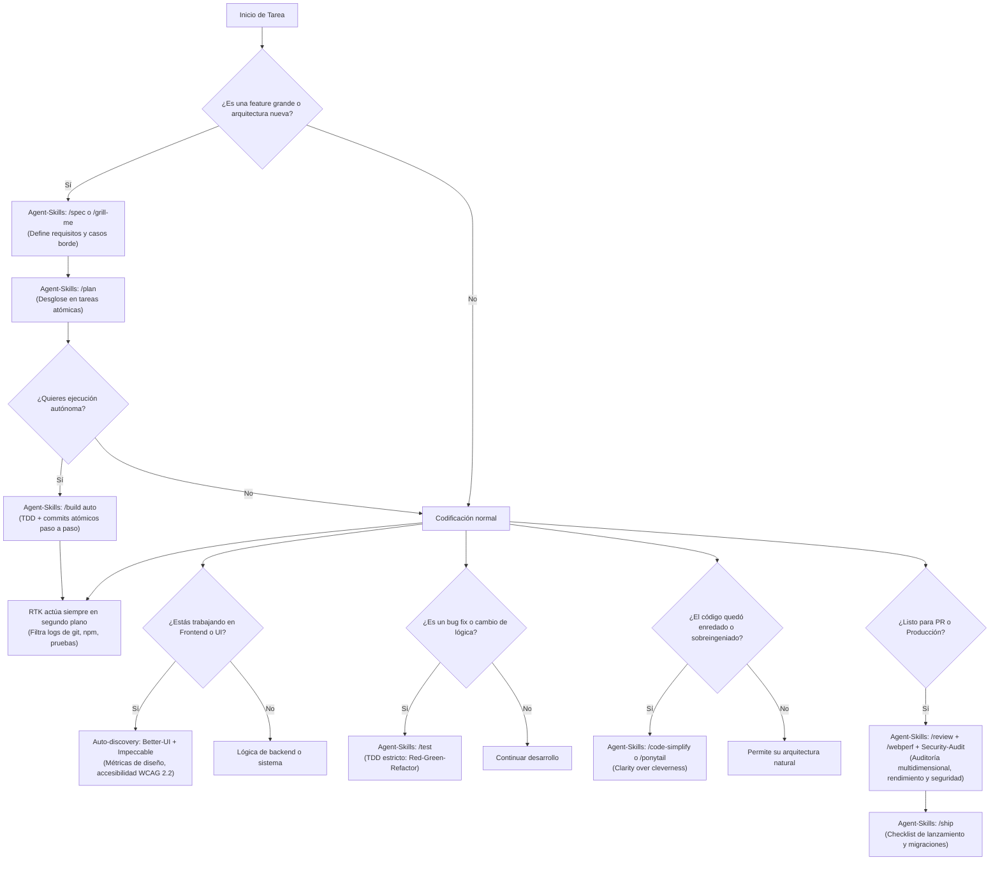

# Guía Completa de Skills y Herramientas en Antigravity

Esta guía contiene la referencia exhaustiva de todas las skills, plugins y herramientas instaladas en tu entorno global (`~/.gemini/config/skills/` y `~/.gemini/config/plugins/`).

Incluye **cómo se activa cada una**, **ejemplos prácticos**, y el **análisis de efectividad en modelos de frontera actuales** (Gemini 2.5/Argon, Claude 3.5/3.7 Sonnet con Extended Thinking, Claude Opus, OpenAI o1/o3-mini) frente a modelos de generaciones previas.

---

## 📑 Tabla de Contenidos

1. [Cuadro Comparativo Resumen](#1-cuadro-comparativo-resumen)
2. [Tabla Rápida de Comandos y Activación](#2-tabla-rápida-de-comandos-y-activación)
3. [Herramientas de Optimización y Flujo](#3-herramientas-de-optimización-y-flujo)
   - [RTK (Rust Token Killer)](#rtk-rust-token-killer)
   - [Ponytail (Lazy Senior Developer)](#ponytail-lazy-senior-developer)
   - [Caveman (Voz Ultra-Concisa)](#caveman-voz-ultra-concisa)
4. [Herramientas de Búsqueda y Navegación](#4-herramientas-de-búsqueda-y-navegación)
   - [Cocoindex-code (CCC)](#cocoindex-code-ccc)
5. [Herramientas de Diseño y Frontend](#5-herramientas-de-diseño-y-frontend)
   - [Better-UI Suite](#better-ui-suite)
   - [Impeccable](#impeccable)
6. [Herramientas de Arquitectura y Validación](#6-herramientas-de-arquitectura-y-validación)
   - [Grill-me & Grill-with-docs](#grill-me--grill-with-docs)
   - [Grill-with-ui](#grill-with-ui)
7. [Auditoría y Ciberseguridad](#7-auditoría-y-ciberseguridad)
   - [Deepsec (Vercel Labs)](#deepsec-vercel-labs)
   - [Security-Audit (Cloudflare)](#security-audit-cloudflare)
   - [SecuritySkills (UnitOneAI - 45 Skills)](#securityskills-unitoneai---45-skills)
8. [Metodología e Ingeniería de Software](#8-metodología-e-ingeniería-de-software)
   - [Agent-Skills (Addy Osmani - 25 Skills)](#agent-skills-addy-osmani---25-skills)
9. [Diagrama de Flujo: Cuándo usar cada herramienta](#9-diagrama-de-flujo-cuándo-usar-cada-herramienta)

---

## 1. Cuadro Comparativo Resumen

| Herramienta | ¿Activar por Defecto? | ¿Recomendado en Modelos Actuales? | Rol Principal |
| :--- | :---: | :---: | :--- |
| **Agent-Skills** | ⚡ **Contextual** | ⭐⭐⭐⭐⭐ **Crítico para Features** | Suite de 25 skills de ingeniería senior (Addy Osmani). Cubre el ciclo SDLC completo: Define, Plan, Build, Verify, Review, Ship. |
| **RTK** | ✅ **SÍ** | ⭐⭐⭐⭐⭐ **Crítico** | Filtra ruido en la terminal; reduce latencia y evita que el modelo pierda la atención en logs largos. |
| **Ponytail** | ❌ **NO** | ⚠️ **Solo bajo demanda** | En modelos nuevos puede causar *sub-ingeniería* y atajos precarios si está forzado. Usar solo con `/ponytail` cuando se desmadre. |
| **Better-UI** | ⚡ **Contextual** | ⭐⭐⭐⭐⭐ **Imprescindible** | Elimina el "AI Slop" visual. Aplica física de resortes, radios concéntricos y accesibilidad WCAG 2.2. |
| **Impeccable** | ⚡ **Contextual** | ⭐⭐⭐⭐⭐ **Muy Alto** | Define un sistema de diseño estricto (`PRODUCT.md` y `DESIGN.md`) con 24 comandos de diseño profesional. |
| **Cocoindex (CCC)** | ⚡ **Contextual** | ⭐⭐⭐⭐⭐ **Muy Alto** | Indexación semántica y AST con Tree-sitter para navegar repos medianos/grandes con precisión quirúrgica. |
| **Grill-with-ui** | ❌ **NO** | ⭐⭐⭐⭐⭐ **Excepcional** | Panel web en el navegador que te desafía con preguntas arquitectónicas antes de escribir código. |
| **Grill-me** | ❌ **NO** | ⭐⭐⭐⭐⭐ **Muy Alto** | Lo mismo que Grill-with-ui pero interactivo directamente en la terminal. |
| **Deepsec** | ❌ **NO** | ⭐⭐⭐⭐⭐ **Nativo para Reasoning** | Escáner de 0-days lógicos de Vercel Labs; creado específicamente para modelos frontier con thinking. |
| **Security-Audit** | ⚡ **Modo Guía** | ⭐⭐⭐⭐⭐ **Imprescindible** | Arnés de Cloudflare en 6 fases con verificadores independientes para eliminar falsos positivos. |
| **SecuritySkills** | ⚡ **Auto-discovery** | ⭐⭐⭐⭐⭐ **Obligatorio** | 45 skills que obligan al modelo a ceñirse a marcos reales (OWASP, NIST, STRIDE), evitando alucinaciones normativas. |
| **Caveman** | ❌ **NO** | ⚠️ **Prescindible** | Ahorra pocos tokens en modelos de razonamiento y puede omitir explicaciones técnicas importantes. |

---

## 2. Tabla Rápida de Comandos y Activación

| Herramienta | Comando Directo | Activación por Lenguaje Natural | Modo de Operación |
| :--- | :--- | :--- | :--- |
| **Agent-Skills** | `/spec`, `/plan`, `/build`, `/test`, `/review`, `/ship` | *"haz TDD de esto"*, *"especifica primero"*, *"revisa calidad"* | Auto-discovery y Comandos Slash |
| **RTK** | `rtk <comando>` / `rtk gain` | Automático en comandos de shell | Regla global de fondo |
| **Ponytail** | `/ponytail` o `/ponytail lite` | *"sé pragmático"*, *"evita sobreingeniería"* | Bajo demanda |
| **Better-UI** | `/better-ui` / `/better-accessibility` | *"pule esta interfaz"*, *"revisa accesibilidad"* | Auto-discovery en Frontend |
| **Impeccable** | `/impeccable <comando>` | *"aplica diseño impecable"*, *"revisa consistencia"* | Auto-discovery en Frontend |
| **Cocoindex (CCC)**| `ccc search <query>` / `/ccc` | *"busca dónde se define tal función"* | Auto-discovery en búsquedas |
| **Grill-with-ui** | `/grill-with-ui <tema>` | *"grill with ui sobre mi plan"* | Bajo demanda (abre navegador) |
| **Grill-me** | `/grill-me <tema>` | *"hazme un grill-me sobre esta arquitectura"* | Bajo demanda (en consola) |
| **Deepsec** | `deepsec init` | *"escanea este repo con deepsec"* | Bajo demanda / CI/CD |
| **Security-Audit** | `/security-audit` | *"¿es seguro este endpoint?"* / *"audita el repo"* | Guía o Auditoría completa |
| **SecuritySkills** | `/threat-modeling`, `/api-security` | *"modela amenazas STRIDE"*, *"revisa prompt injection"* | Auto-discovery por contexto |
| **Caveman** | `/caveman` | *"modo cavernícola"*, *"sé ultra conciso"* | Bajo demanda |

---

## 3. Herramientas de Optimización y Flujo

---

### RTK (Rust Token Killer)

#### ¿Para qué sirve?
Filtra y compacta las salidas verbose de comandos de consola (`git status`, `git diff`, `npm test`, `pytest`, `cargo build`). Oculta logs repetitivos, spinners y pruebas que pasaron con éxito, conservando intactos errores, advertencias y rutas de archivos.

#### ¿Cómo funciona?
Interpreta los flujos de texto en milisegundos mediante un binario en Rust antes de que los datos ingresen a la ventana de contexto del LLM.

#### Comportamiento en Modelos Actuales vs. Antiguos:
- **En modelos antiguos:** Era útil para no reventar ventanas de 8k o 32k tokens.
- **En modelos actuales (Gemini 2.5, Claude 3.7):** Es **crítico para evitar la "dilución de atención" (*needle in a haystack*)**. Cuando un modelo recibe 5,000 líneas de un test suite masivo, pierde el foco del error real. RTK reduce la latencia (*Time to First Token*) y ahorra miles de tokens en llamadas continuas.

#### ¿Se puede activar por defecto?
**Sí.** Se configura mediante la regla obligatoria en `~/.gemini/config/plugins/rtk/rules/AGENTS.md`.

#### ¿Lo recomendarías por defecto y en qué casos?
**Sí, 100% recomendado en todos los proyectos.** No altera la calidad de las respuestas y hace que el asistente trabaje más rápido y con mayor precisión.

#### ¿Cómo se activa normalmente?
- Prefijando comandos en terminal: `rtk git status`, `rtk npm test`, `rtk git diff`.
- Ver estadísticas de ahorro: `rtk gain` o `rtk gain --history`.
- Ejecutar comando sin filtro en caso de necesitar la salida pura: `rtk proxy <comando>`.

#### Casos de ejemplo prácticos:
1. **Tests unitarios masivos:** Ejecutas `rtk npm test`. Si pasaron 200 tests y falló 1, RTK oculta los 200 tests exitosos y le pasa al modelo únicamente el stack trace del que falló.
2. **Revisión de cambios antes de commit:** `rtk git status` te muestra el resumen compacto de ramas y archivos modificados sin cabeceras redundantes.

---

### Ponytail (Lazy Senior Developer)

#### ¿Para qué sirve?
Obliga al modelo a actuar con mentalidad de programador senior pragmático: resolver el problema con el menor código nuevo posible, evitar meter dependencias de terceros si el lenguaje ya tiene la solución nativa, y respetar la filosofía YAGNI (*You Aren't Gonna Need It*).

#### ¿Cómo funciona?
Aplica una "escalera de decisiones" de 7 niveles antes de escribir código: ¿esta función debe existir? ¿ya existe algo similar en el repo? ¿se resuelve con la librería estándar? ¿se puede resolver en una línea?

#### Comportamiento en Modelos Actuales vs. Antiguos:
- **En modelos antiguos:** Era imprescindible porque los LLMs tendían a sobrediseñar e instalar librerías para cualquier tontería.
- **En modelos actuales con razonamiento profundo (Argon, Opus, o1):** **Puede ser perjudicial si se deja activo por defecto.** Los modelos de frontera razonan mucho mejor sobre arquitectura. Si les fuerzas la regla de *"el diff más corto siempre gana"*, caen en **sub-ingeniería (*under-engineering*)**: meten un `if/else` espagueti en vez de una clase desacoplada o dejan atajos con comentarios (`shortcut:`) en lugar de construir la arquitectura que sí saben hacer.

#### ¿Se puede activar por defecto?
**Técnicamente sí, pero NO se recomienda por defecto.**

#### ¿Lo recomendarías por defecto y en qué casos?
**No por defecto.** Es excelente **bajo demanda** cuando notas que el modelo está inventando dependencias innecesarias o cuando quieres auditar código muerto con `/ponytail-audit`. Si deseas usarlo habitualmente, usa el modo `/ponytail lite`.

#### ¿Cómo se activa normalmente?
- Comando directo: `/ponytail` (modo full), `/ponytail lite`, `/ponytail ultra`.
- Frases clave: *"ponytail"*, *"sé pragmático"*, *"dame la solución más simple que funcione"*, *"nada de sobreingeniería"*.
- Desactivar: `"stop ponytail"` o `"normal mode"`.

#### Casos de ejemplo prácticos:
1. **Frenar dependencias innecesarias:** Le pides un selector de fechas con `/ponytail` y el modelo usará `<input type="date">` nativo en lugar de proponerte instalar una librería pesada de React.
2. **Limpieza de deuda técnica:** Ejecutas `/ponytail-audit` para que revise tu proyecto y señale qué funciones auxiliares o abstracciones complejas están de más.

---

### Caveman (Voz Ultra-Concisa)

#### ¿Para qué sirve?
Elimina saludos, introducciones amables, conclusiones y explicaciones obvias. Comunica las respuestas en estilo telegráfico técnico ("modo cavernícola").

#### ¿Cómo funciona?
Restringe el prompt de salida forzando al modelo a responder primero con el código y comandos, omitiendo palabras superfluas.

#### Comportamiento en Modelos Actuales vs. Antiguos:
- **En modelos antiguos:** Ahorraba bastantes tokens de salida cuando los límites eran estrictos.
- **En modelos actuales:** **Pierde gran parte de su valor.** En modelos de razonamiento (como o1 o Claude con thinking), el mayor coste ocurre en los tokens de pensamiento interno, que Caveman no reduce. Además, al forzar respuestas telegráficas se pueden perder advertencias de seguridad o matices de concurrencia importantes.

#### ¿Se puede activar por defecto?
**Sí, pero no es recomendable para trabajo diario.**

#### ¿Lo recomendarías por defecto y en qué casos?
**Solo si programas desde una terminal muy reducida o buscas velocidad pura sin explicaciones.**

#### ¿Cómo se activa normalmente?
- Comando: `/caveman`
- Frases clave: *"caveman mode"*, *"habla como cavernícola"*, *"sé telegráfico, cero relleno"*.
- Desactivar: `"stop caveman"` o `"normal mode"`.

#### Casos de ejemplo prácticos:
1. **Revisión relámpago de PR:** Ejecutas `/caveman-review` y el modelo te devuelve una única línea por cada bug detectado: `archivo.js:45 -> falta validar null -> pon if (!user) return`.

---

## 4. Herramientas de Búsqueda y Navegación

---

### Cocoindex-code (CCC)

#### ¿Para qué sirve?
Búsqueda de código inteligente basada en sintaxis real (AST) y significado semántico, superando las limitaciones de `grep` o búsquedas de texto plano.

#### ¿Cómo funciona?
Usa el motor **Tree-sitter** para trocear el código fuente en bloques semánticos (funciones, clases, interfaces, tipos) y genera un índice local con SQLite y embeddings en Rust. Solo le envía al modelo el bloque exacto que necesita.

#### Comportamiento en Modelos Actuales vs. Antiguos:
- **En modelos antiguos:** Evitaba que el modelo se desbordara por falta de contexto.
- **En modelos actuales:** **Sigue siendo de altísimo valor.** Aunque modelos como Gemini procesen 1 millón de tokens, volcar 100 archivos en cada consulta es carísimo, lento y sufre de degradación de atención. CCC permite búsquedas semánticas precisas (*"dónde se maneja el refresh token"*) entregando el nodo exacto del AST.

#### ¿Se puede activar por defecto?
**Sí, como herramienta de búsqueda contextual.**

#### ¿Lo recomendarías por defecto y en qué casos?
**Muy recomendado en proyectos medianos y grandes (más de 30-50 archivos).**

#### ¿Cómo se activa normalmente?
- Detección automática al pedir: *"busca dónde se gestionan los pagos"*.
- Comandos CLI:
  ```bash
  ccc init -f      # Inicializa el índice
  ccc index        # Actualiza el índice local
  ccc search "texto o concepto"
  ```

#### Casos de ejemplo prácticos:
1. **Rastreo de interfaces:** `ccc search "clases que implementan BaseAuthService"` encuentra la definición y sus subclases ignorando menciones en documentación.
2. **Refactorización sin grep ciego:** Buscas un método genérico como `process()` y CCC localiza únicamente las definiciones del método en clases de servicio, no las 500 llamadas irrelevantes.

---

## 5. Herramientas de Diseño y Frontend

---

### Better-UI Suite

#### ¿Para qué sirve?
Corrige los defectos típicos de las interfaces generadas por IA (*"AI Slop"*), dotando a componentes web y móviles de calidad de ingeniería de diseño profesional.

#### Habilidades que componen la suite:
- **`better-ui`:** Detalles de micro-interacciones, sombras estructuradas y física de movimiento.
- **`better-accessibility`:** Cumplimiento de WCAG 2.2, contraste para daltonismo y navegación por teclado.
- **`better-colors`:** Paletas semánticas y tokens de color con soporte OKLCH.
- **`better-layout`:** Flexbox, Grid y espaciado proporcional adaptativo.
- **`better-typography`:** Escalas tipográficas, jerarquía e interlineado armónico.
- **`better-interface`:** Auditoría integral que combina todas las anteriores.

#### Comportamiento en Modelos Actuales vs. Antiguos:
- **En modelos antiguos:** Corregía errores básicos de CSS.
- **En modelos actuales:** **Imprescindible.** Aunque los modelos de hoy dominan Tailwind CSS, tienden a generar interfaces visualmente monótonas (Inter font, bordes arbitrarios, sombras planas). Better-UI inyecta fórmulas matemáticas reales (como el radio concéntrico $R_{\text{interno}} = R_{\text{externo}} - \text{padding}$).

#### ¿Se puede activar por defecto?
**Sí, en proyectos Frontend.**

#### ¿Lo recomendarías por defecto y en qué casos?
**Totalmente recomendado siempre que crees o edites componentes visuales (React, Flutter, Vue, CSS).**

#### ¿Cómo se activa normalmente?
- Auto-discovery al pedir diseñar o retocar componentes UI.
- Comandos directos: `/better-ui`, `/better-accessibility`.
- Frases clave: *"pule este botón con better-ui"*, *"revisa la accesibilidad de este modal"*.

#### Casos de ejemplo prácticos:
1. **Creación de un botón interactivo:** Configura el estado hover con elevación sutil, transición de resorte (*spring physics*), área táctil de al menos 44x44px y feedback táctil de escala (`scale(0.96)`) en el estado activo.
2. **Auditoría de formularios:** Detecta si los inputs carecen de atributos ARIA, si los mensajes de error tienen bajo contraste o si se rompe la navegación con la tecla Tab.

---

### Impeccable

#### ¿Para qué sirve?
Garantiza coherencia estética y disciplina matemática en el diseño frontend. Previene el desorden visual mediante un sistema de diseño persistente en dos archivos: `PRODUCT.md` (objetivo del producto) y `DESIGN.md` (tokens, tipografías y reglas de layout).

#### ¿Cómo funciona?
Cuenta con un vocabulario de 24 comandos de diseño (`/impeccable polish`, `/impeccable critique`, `/impeccable audit`) y unas 60 reglas heurísticas que prohíben patrones trillados de IA (como degradados morados genéricos o tarjetas dentro de tarjetas sin sentido).

#### Comportamiento en Modelos Actuales vs. Antiguos:
- **En modelos actuales:** **Muy Alto Valor.** Proporciona el marco conceptual y los tokens que impiden que el modelo improvise estilos aleatorios entre distintas pantallas.

#### ¿Se puede activar por defecto?
**Sí, en proyectos con interfaz gráfica.**

#### ¿Lo recomendarías por defecto y en qué casos?
**Sí, en combinación con `better-ui`.**

#### ¿Cómo se activa normalmente?
- Comandos CLI y de agente:
  ```bash
  /impeccable init          # Crea PRODUCT.md y DESIGN.md
  /impeccable polish        # Refina espaciados y jerarquía visual
  /impeccable audit         # Audita consistencia y accesibilidad
  /impeccable bolder        # Da más carácter a un diseño plano
  /impeccable quieter       # Suaviza un diseño recargado
  ```
- Frases clave: *"aplica diseño impecable"*, *"mantén la consistencia visual del sistema de diseño"*.

#### Casos de ejemplo prácticos:
1. **Unificación de un Dashboard:** `/impeccable polish este dashboard` ajusta los múltiplos de espaciado a una escala estricta de 4px/8px y aplica números tabulares a las métricas financieras.

---

## 6. Herramientas de Arquitectura y Validación

---

### Grill-me & Grill-with-docs

#### ¿Para qué sirve?
Frena el impulso de la IA de programar inmediatamente. Transforma al modelo en un arquitecto de software exigente que te interroga sobre decisiones de diseño, casos límite y requisitos antes de escribir una sola línea de código.

#### ¿Cómo funciona?
Formula preguntas incisivas una a una en la consola, desafiando tus suposiciones sobre concurrencia, idempotencia, fallos de red y modelos de datos.

#### Comportamiento en Modelos Actuales vs. Antiguos:
- **En modelos antiguos:** Planteaba preguntas lógicas básicas.
- **En modelos actuales:** **Excepcional.** Modelos como Gemini Argon o Claude Opus razonan a un nivel tan profundo que descubren huecos de arquitectura complejos (condiciones de carrera distribuidas, fallos de coherencia en caché, problemas de rollback en transacciones) antes de que empieces a codificar.

#### ¿Se puede activar por defecto?
**NO.** (Bloquearía cada tarea menor con un interrogatorio).

#### ¿Lo recomendarías por defecto y en qué casos?
**No por defecto; solo bajo demanda para diseñar funcionalidades grandes o refactorizaciones de fondo.**

#### ¿Cómo se activa normalmente?
- Comando: `/grill-me <idea o propuesta>`
- Frases clave: *"hazme un grill-me sobre esta arquitectura"*, *"desafía mi plan de diseño"*, *"pon a prueba mi propuesta"*.

#### Casos de ejemplo prácticos:
1. **Migración de base de datos:** `/grill-me Quiero migrar de Firebase Auth a Supabase sin desconectar a los usuarios activos`. El modelo te preguntará cómo manejarás la sincronización de contraseñas con hash, tokens JWT caducados y fallbacks en caso de caída.

---

### Grill-with-ui

#### ¿Para qué sirve?
La misma metodología de interrogatorio de `grill-me`, pero **levantando un servidor local en Node.js y abriendo una interfaz gráfica en tu navegador web** en lugar de forzarte a leer bloques largos de preguntas en la consola.

#### ¿Cómo funciona?
1. Ejecuta `server.mjs` y abre `page.html` en el navegador.
2. Presenta cada pregunta en una tarjeta interactiva con recomendaciones sugeridas.
3. Te permite contestar en cualquier orden, debatir preguntas individuales en hilos y enviar todas las respuestas en un único lote al pulsar *"Send to Agent"*.

#### Comportamiento en Modelos Actuales vs. Antiguos:
- **En modelos actuales:** **Máximo confort ergonómico.** Permite explorar las preguntas profundas de los modelos modernos sin saturar la ventana de la terminal.

#### ¿Se puede activar por defecto?
**NO.** Se usa conscientemente al planificar.

#### ¿Cómo se activa normalmente?
- Comando: `/grill-with-ui <tema>`
- Reanudar sesión: `/grill-with-ui resume`
- Frases clave: *"grill with ui sobre el sistema de cobros"*.

#### Casos de ejemplo prácticos:
1. **Diseño de arquitectura en pantalla grande:** `/grill-with-ui arquitectura de autenticación multifactor (MFA)`. Se abre el navegador, seleccionas las opciones recomendadas en las tarjetas y envías el lote completo al agente con un clic.

---

## 7. Auditoría y Ciberseguridad

---

### Deepsec (Vercel Labs)

#### ¿Para qué sirve?
Escáner y auditor de seguridad de código abierto creado por **Vercel Labs**. Detecta vulnerabilidades lógicas profundas (BOLA/IDOR, derivaciones de autenticación, fallos de aislamiento entre tenants) que los linters estáticos convencionales no pueden ver.

#### ¿Cómo funciona?
1. Realiza un mapeo rápido de patrones de superficie de ataque (gratuito).
2. Envía áreas de riesgo a modelos de frontera configurados con razonamiento profundo (`--thinking-level`).
3. Guarda todo su estado en una carpeta `.deepsec/` en el proyecto.
4. Es **reanudable**: si se corta por límite de presupuesto o tiempo, continúa exactamente donde quedó.

#### Comportamiento en Modelos Actuales vs. Antiguos:
- **En modelos antiguos:** Apenas funcionaba bien porque carecían de razonamiento extendido.
- **En modelos actuales:** **Fue diseñado nativamente para esta generación de modelos.** Aprovecha el razonamiento profundo de modelos como o1 o Claude Sonnet para encontrar vulnerabilidades lógicas en código real.

#### ¿Se puede activar por defecto?
**NO.** Consume tiempo de cómputo y presupuesto de tokens significativo.

#### ¿Cómo se activa normalmente?
- Desde la consola:
  ```bash
  deepsec init                                    # Asistente interactivo guiado
  deepsec init --max-cost-usd 20 --max-duration 30m # Con límites de costo/tiempo
  ```
- Exportar reporte:
  ```bash
  cd .deepsec
  pnpm deepsec export --format md-dir --out ./findings
  ```
- Pidiéndoselo al agente: *"audita la seguridad de este backend con deepsec"*.

#### Casos de ejemplo prácticos:
1. **Auditoría antes de lanzamiento:** Ejecutas `deepsec init` en un backend de Node/Python para verificar que ningún usuario pueda acceder a datos de otro manipulando parámetros de consulta (`?userId=123`).

---

### Security-Audit (Cloudflare)

#### ¿Para qué sirve?
El arnés oficial de auditoría de seguridad defensiva en 6 fases desarrollado por el equipo de ciberseguridad de **Cloudflare**.

#### ¿Cómo funciona?
- **Modo Guía (*Guidance mode*):** Responde preguntas sobre seguridad de código o revisa un archivo puntual sin generar carpetas ni auditorías pesadas.
- **Modo Full Audit:** Ejecuta un flujo estructurado: mapeo de límites de confianza (`coverage-ledger.json`), caza por vectores de ataque, verificación independiente (agentes separados intentan refutar cada hallazgo para matar falsos positivos) y generación de reportes validados (`findings.json`).

#### Comportamiento en Modelos Actuales vs. Antiguos:
- **En modelos actuales:** **Excelente.** La fase de verificación independiente es clave en modelos actuales para filtrar alucinaciones y confirmar únicamente vulnerabilidades reales con pruebas de reproducción.

#### ¿Se puede activar por defecto?
- El **Modo Guía sí** (está listo para resolver dudas).
- El **Modo Full Audit no** (solo bajo demanda explícita).

#### ¿Cómo se activa normalmente?
- Consultas puntuales: *"¿Es seguro este endpoint de login?"*
- Auditoría completa: *"Realiza una auditoría completa de seguridad con security-audit"*.

#### Casos de ejemplo prácticos:
1. **Revisión de trust boundaries:** Le pides auditar cómo se comunican dos servicios internos para verificar que los datos no viajen sin cifrar ni validar firmas.

---

### SecuritySkills (UnitOneAI - 45 Skills)

#### ¿Para qué sirve?
Un catálogo de **45 habilidades estructuradas** respaldadas por marcos oficiales de la industria (OWASP Top 10, NIST CSF, MITRE ATT&CK, CIS Controls, STRIDE, ISO 27001, SOC 2, HIPAA, PCI-DSS).

#### Distribución de las 45 habilidades:

| Área | Skills Incluidas | Marco Oficial |
| :--- | :--- | :--- |
| **🤖 IA y LLMs** | `agent-security`, `agentic-top-10`, `ai-data-privacy`, `llm-top-10`, `model-supply-chain`, `prompt-injection` | OWASP Top 10 for LLMs / MITRE ATLAS |
| **🌐 AppSec** | `api-security`, `dependency-scanning`, `owasp-top-10-web`, `secure-code-review`, `threat-modeling` | OWASP Top 10, ASVS, STRIDE |
| **☁️ Cloud & Infra** | `aws-review`, `azure-review`, `container-security`, `gcp-review`, `iac-security` | CIS Benchmarks, NIST SP 800-145 |
| **📜 Compliance** | `hipaa-review`, `iso27001-gap`, `nist-csf-assessment`, `pci-dss-review`, `soc2-gap` | HIPAA, PCI-DSS v4, SOC 2 Type II, ISO 27001 |
| **⚙️ DevSecOps** | `dast-config`, `pipeline-security`, `sast-config`, `secrets-management` | SLSA v1.0, OWASP SAMM |
| **🔑 IAM & Accesos** | `access-review`, `iam-review`, `privileged-access`, `rbac-design`, `zero-trust-assessment` | NIST SP 800-63, NIST SP 800-162 |
| **🚨 Incidentes** | `containment`, `forensics-checklist`, `ir-playbook`, `post-incident-review` | NIST SP 800-61, MITRE ATT&CK |
| **🌐 Redes** | `dns-security`, `firewall-review`, `segmentation` | CIS Controls v8 (Redes) |
| **📊 SecOps** | `alert-triage`, `detection-engineering`, `log-analysis`, `siem-rules` | SIGMA, MITRE ATT&CK Detections |
| **🔍 Vulnerabilidades**| `cve-triage`, `patch-prioritization`, `sbom-analysis`, `scanner-tuning` | CVSS v4.0, SSVC, EPSS, CISA KEV |

#### Comportamiento en Modelos Actuales vs. Antiguos:
- **En modelos actuales:** **Obligatorio.** Sin estas skills, los modelos modernos alucinan identificadores de normativas (inventan artículos de ISO o controles de NIST). Estas skills anclan las respuestas a controles reales y verificables.

#### ¿Se puede activar por defecto?
**Operan mediante auto-discovery por contexto.** Se cargan solas únicamente cuando tocas código relevante.

#### ¿Cómo se activa normalmente?
- **Automáticamente por contexto:** Si editas un Dockerfile entra `container-security`; si tocas un prompt de IA entra `prompt-injection`.
- **Por comando directo:**
  - `/threat-modeling`
  - `/secure-code-review`
  - `/api-security`
  - `/prompt-injection`
  - `/cve-triage CVE-2024-XXXX`
  - `/soc2-gap`

#### Casos de ejemplo prácticos:
1. **Defensa contra inyecciones de prompt:** Usas `/prompt-injection` sobre tu código de integración con Gemini para asegurar que un usuario malintencionado no pueda burlar las instrucciones del sistema.
2. **Priorización de parches con EPSS:** Usas `/cve-triage CVE-2023-4863` y el modelo consulta las métricas de explotación real en lugar de alarmarse innecesariamente por el número CVSS en solitario.

---

## 8. Metodología e Ingeniería de Software

---

### Agent-Skills (Addy Osmani - 25 Skills)

#### ¿Para qué sirve?
Es la suite de referencia para **transformar a un agente de código de un programador junior apresurado a un equipo de ingeniería senior disciplinado**. Creada por **Addy Osmani** (Director de Ingeniería en Google Chrome), codifica los flujos de trabajo, contratos de calidad (*quality gates*) y metodologías rigurosas que siguen los equipos de software de alto rendimiento.

Evita el problema más común de los asistentes de código: lanzarse a escribir archivos de inmediato sin entender los requisitos, sin escribir pruebas automatizadas y dejando deuda técnica o regresiones inadvertidas.

```
  DEFINE          PLAN           BUILD          VERIFY         REVIEW          SHIP
 ┌──────┐      ┌──────┐      ┌──────┐      ┌──────┐      ┌──────┐      ┌──────┐
 │ Idea │ ───▶ │ Spec │ ───▶ │ Code │ ───▶ │ Test │ ───▶ │  QA  │ ───▶ │  Go  │
 │Refine│      │  PRD │      │ Impl │      │Debug │      │ Gate │      │ Live │
 └──────┘      └──────┘      └──────┘      └──────┘      └──────┘      └──────┘
  /spec          /plan          /build        /test         /review       /ship
```

#### ¿Cómo funciona?
1. **Progressive Disclosure:** Las 25 skills **no se cargan completas en el contexto por defecto**. Antigravity mantiene en memoria únicamente un índice ligero con sus nombres y descripciones. El archivo exhaustivo `SKILL.md` (con checklists y reglas) se inyecta en la conversación de manera transparente solo cuando se invoca un comando o cuando la tarea entra en su ámbito.
2. **Quality Gates Inquebrantables:** Cada habilidad establece condiciones de parada obligatorias. Por ejemplo, en `/test` (`test-driven-development`) el agente tiene prohibido escribir código de producción hasta que un test automatizado falle primero demostrando el bug (*red*), y luego escribe el mínimo código para que pase (*green*).
3. **Comandos Slash Integrados:** Mapea 9 comandos directos que cubren el ciclo de vida del software.
4. **Modo Autónomo Aprobado (`/build auto`):** Para cuando ya existe una especificación (`/spec`), `/build auto` elabora el plan detallado, te pide confirmación una única vez y después ejecuta cada tarea secuencialmente: escribe el test, implementa el código, verifica que pase y hace el commit atómico correspondiente, deteniéndose únicamente si una prueba falla o si se topa con una decisión ambigua.

#### Comportamiento en Modelos Actuales vs. Antiguos:
- **En modelos antiguos (GPT-3.5, Gemini 1.0):** Les costaba mantener la disciplina de 6 etapas; solían alucinar pasos intermedios o perder la atención tras dos o tres iteraciones.
- **En modelos actuales de frontera (Gemini 2.5 Pro/Flash, Claude 3.7 Sonnet con Extended Thinking, OpenAI o1/o3):** **Es su mejor complemento.** Los modelos modernos poseen una capacidad de razonamiento sobresaliente, pero tienden a ser demasiado entusiastas (*eager*) y asumir requisitos no especificados. Agent-Skills les impone una estructura de ingeniería formal que aprovecha al máximo su razonamiento sin desperdiciar tokens en código innecesario.

#### ¿Se puede activar por defecto?
- **Como catálogo global de Auto-discovery:** **SÍ, y ya está activo.** Cada vez que el agente detecta que diseñas una API, optimizas webperf o debugueas un error, la skill apropiada se activa automáticamente.
- **Como pipeline obligatorio forzado para cada mensaje:** **NO se recomienda.** Si obligaras al modelo a pasar por `/spec` -> `/plan` -> `/test` para responder una pregunta rápida de sintaxis o para cambiar un texto en la UI, el entorno se volvería burocrático e ineficiente.

#### ¿Lo recomendarías por defecto y en qué casos?
**Recomendado 100% en modo Contextual / Por Demanda.**

- **Usa sus comandos activamente cuando:**
  - Vas a construir un feature nuevo o arquitectura no trivial (`/spec` y `/plan`).
  - Arreglas un bug crítico donde no puedes permitirte regresiones (`/test`).
  - Vas a abrir un Pull Request o hacer merge (`/review`).
  - El código funciona pero terminó enredado y poco legible (`/code-simplify`).
  - Vas a desplegar cambios con migraciones de datos a producción (`/ship`).

#### Catálogo de las 25 Skills por Etapa:

| Etapa | Comando Directo | Skills Incluidas | Propósito Principal |
| :--- | :--- | :--- | :--- |
| **1. Definir** | `/spec` | `spec-driven-development`<br>`interview-me`<br>`idea-refine` | Escribe especificaciones y PRD antes de programar; interroga dudas una a una hasta tener 95% de certeza. |
| **2. Planificar** | `/plan` | `planning-and-task-breakdown`<br>`context-engineering` | Divide el trabajo en tareas atómicas y prepara el contexto del agente para la sesión. |
| **3. Construir** | `/build` / `/build auto` | `incremental-implementation`<br>`api-and-interface-design`<br>`frontend-ui-engineering` | Implementación en rebanadas delgadas (*thin slices*), diseño de contratos de API estables e interfaces accesibles. |
| **4. Verificar** | `/test` | `test-driven-development`<br>`browser-testing-with-devtools`<br>`debugging-and-error-recovery` | TDD estricto (Red-Green-Refactor), pruebas en navegadores reales vía DevTools y diagnóstico sistemático de raíz. |
| **5. Calidad** | `/constraints`<br>`/review`<br>`/code-simplify` | `constraint-driven-development`<br>`code-review-and-quality`<br>`code-simplification`<br>`doubt-driven-development`<br>`source-driven-development` | Fija restricciones no negociables, revisión multidimensional (seguridad, legibilidad, performance) y simplificación radical. |
| **6. Producción** | `/webperf`<br>`/ship` | `performance-optimization`<br>`shipping-and-launch`<br>`security-and-hardening`<br>`ci-cd-and-automation`<br>`observability-and-instrumentation`<br>`deprecation-and-migration`<br>`git-workflow-and-versioning`<br>`documentation-and-adrs`<br>`using-agent-skills` | Auditoría de Core Web Vitals, checklist de pre-lanzamiento, migraciones de base de datos sin downtime y observabilidad. |

#### Casos de ejemplo prácticos:

1. **Construcción de una funcionalidad completa con `/spec` y `/build auto`:**
   - Escribes: `/spec Sistema de exportación de reportes mensuales en PDF y Excel`.
   - El modelo define entradas, salidas, manejo de errores y compatibilidad.
   - Ejecutas `/build auto` para que despiece el plan y lo ejecute tarea por tarea con tests y commits limpios.
2. **Corrección de un bug escurridizo con `/test` (TDD):**
   - Escribes: `/test El cálculo de impuestos falla cuando el usuario tiene descuentos combinados`.
   - El modelo escribe primero el test unitario que reproduce el fallo con números reales (rojo). Luego ajusta la fórmula matemática hasta que el test pase (verde), garantizando que el bug nunca vuelva a ocurrir.
3. **Revisión antes de Pull Request con `/review`:**
   - Escribes: `/review este branch contra main`.
   - El modelo audita el diff en 5 ejes: corrección funcional, legibilidad, arquitectura, seguridad y rendimiento, entregando un reporte accionable.

---

## 9. Diagrama de Flujo: Cuándo usar cada herramienta



