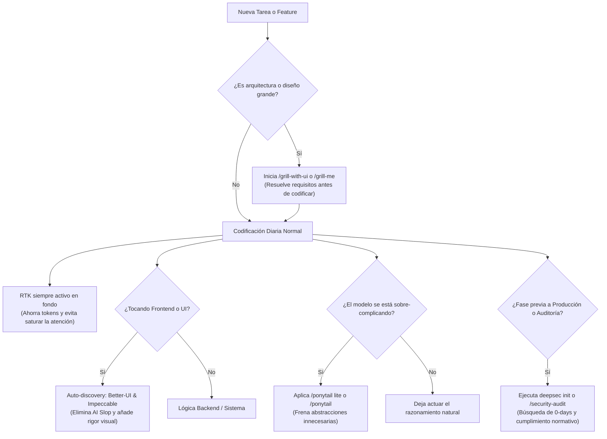

# Guía Definitiva y Análisis Crítico de Skills en Modelos Modernos

Este documento es una investigación exhaustiva y referencia técnica de todas las skills, plugins y herramientas de desarrollo instaladas en tu entorno global (`~/.gemini/config/skills/` y `~/.gemini/config/plugins/`).

Incluye un **análisis profundo sobre su comportamiento en modelos de frontera actuales** (Gemini 2.5/Flash/Pro/Argon, Claude 3.5/3.7 Sonnet con Extended Thinking, Claude Opus, OpenAI o1/o3-mini) frente a modelos de generaciones anteriores.

---

## 📑 Tabla de Contenidos

1. [Matriz Comparativa: Modelos Anteriores vs. Modelos Actuales](#1-matriz-comparativa-modelos-anteriores-vs-modelos-actuales)
2. [Análisis Profundo por Herramienta](#2-análisis-profundo-por-herramienta)
   - [RTK (Rust Token Killer)](#rtk-rust-token-killer)
   - [Ponytail (Lazy Senior Dev) — El dilema de la sub-ingeniería](#ponytail-lazy-senior-dev--el-dilema-de-la-sub-ingeniería)
   - [Caveman — ¿Ahorro real o pérdida de razonamiento?](#caveman--ahorro-real-o-pérdida-de-razonamiento)
   - [Cocoindex-code (CCC) — Precisión AST vs. Ventanas de 1M tokens](#cocoindex-code-ccc--precisión-ast-vs-ventanas-de-1m-tokens)
   - [Better-UI & Impeccable — Eliminando el "AI Slop" visual](#better-ui--impeccable--eliminando-el-ai-slop-visual)
   - [Grill-me & Grill-with-ui — Frenar el entusiasmo precipitado](#grill-me--grill-with-ui--frenar-el-entusiasmo-precipitado)
   - [Deepsec (Vercel Labs) — Diseñado nativamente para modelos de razonamiento](#deepsec-vercel-labs--diseñado-nativamente-para-modelos-de-razonamiento)
   - [Security-Audit (Cloudflare) & SecuritySkills (UnitOneAI) — Blindaje contra alucinaciones](#security-audit-cloudflare--securityskills-unitoneai--blindaje-contra-alucinaciones)
3. [Recomendación Estratégica de Uso Diario](#3-recomendación-estratégica-de-uso-diario)

---

## 1. Matriz Comparativa: Modelos Anteriores vs. Modelos Actuales

| Skill / Herramienta | Efectividad en Modelos Anteriores (GPT-3.5 / Claude 3) | Efectividad en Modelos Actuales (Gemini 2.5/Argon, Sonnet 3.7, Opus, o1) | ¿Vale la pena hoy en día? | Veredicto de Activación |
| :--- | :--- | :--- | :--- | :--- |
| **RTK** | ⭐⭐⭐⭐⭐ Imprescindible (contextos de 8k-32k). | ⭐⭐⭐⭐⭐ **Crítico.** Evita la dilución de atención (*needle in haystack*) y reduce latencia (TTFT). | **SÍ, 100% indispensable.** | **Activo por defecto (Regla global)** |
| **Ponytail** | ⭐⭐⭐⭐⭐ Milagroso para frenar código inflado (*bloat*). | ⚠️ **Riesgoso si es rígido.** Puede causar *under-engineering*, atajos precarios y castrar el razonamiento arquitectónico natural. | **SÍ, pero solo bajo demanda o en modo `lite`.** | **Inactivo por defecto (Usar con `/ponytail` o `/ponytail lite`)** |
| **Caveman** | ⭐⭐⭐⭐ Ahorraba tokens visibles valiosos. | ⚠️ **Prescindible.** En modelos de razonamiento el costo está en los *thinking tokens* internos. La voz cavernícola degrada explicaciones complejas. | **Bajo valor / Solo preferencia personal.** | **Inactivo por defecto (Solo bajo demanda)** |
| **Cocoindex-Code (CCC)** | ⭐⭐⭐ Bueno para paliar ventanas pequeñas. | ⭐⭐⭐⭐⭐ **Muy Alto.** Aunque la ventana sea de 1M-2M tokens, volcar código masivo genera alucinaciones y búsquedas ciegas. El AST de Tree-sitter da precisión quirúrgica. | **SÍ, muy valioso en repos medianos/grandes.** | **Auto-discovery / Bajo demanda** |
| **Better-UI & Impeccable** | ⭐⭐⭐ Ayudaba con CSS básico. | ⭐⭐⭐⭐⭐ **Imprescindibles.** Los modelos nuevos dominan Tailwind pero siguen generando "AI Slop" visual genérico. Estas skills inyectan matemática de diseño real (curvas de resorte, radios concéntricos, WCAG 2.2). | **SÍ, el estándar de oro en Frontend.** | **Auto-discovery en archivos UI** |
| **Grill-me / Grill-with-ui** | ⭐⭐⭐⭐ Muy útil para aclarar ideas. | ⭐⭐⭐⭐⭐ **Excepcional.** Los modelos modernos razonan tanto que hacen preguntas de arquitectura e idempotencia mucho más profundas antes de programar. | **SÍ, el mejor arnés pre-código.** | **Inactivo por defecto (Usar con `/grill-with-ui`)** |
| **Deepsec** | ❌ No funcionaba bien (requería razonamiento profundo). | ⭐⭐⭐⭐⭐ **Nativo para esta era.** Creado expresamente por Vercel para modelos de frontera a máximo nivel de *thinking*. | **SÍ, auditoría profunda real.** | **Inactivo por defecto (Bajo demanda / CI/CD)** |
| **Security-Audit & SecuritySkills** | ⭐⭐⭐ Respuestas teóricas. | ⭐⭐⭐⭐⭐ **Obligatorio para evitar alucinaciones.** Los LLMs modernos inventan números de control normativos (NIST/ISO/SOC2); estas skills los anclan a identificadores reales. | **SÍ, rigor profesional auditable.** | **Auto-discovery / Bajo demanda** |

---

## 2. Análisis Profundo por Herramienta

---

### RTK (Rust Token Killer)

#### ¿Qué decían los escépticos?
*"Con modelos actuales que aceptan 1 o 2 millones de tokens en la ventana de contexto (como Gemini 1.5/2.5 o Claude), ¿realmente hace falta una herramienta en Rust para filtrar la salida de la terminal?"*

#### Lo que demostró la investigación técnica:
**Es completamente indispensable.** La creencia de que "como el contexto es infinito, ya no importa el ruido" es un grave error de ingeniería:
1. **Dilución de la Atención (*Needle in a Haystack Effect*):** Cuando un comando como `npm test` o `cargo test` vuelca 3,000 líneas de tests que pasaron con éxito, el modelo sufre fatiga de atención y pierde de vista las 4 líneas del error real. RTK colapsa los tests verdes y muestra solo el stack trace del fallo.
2. **Latencia (*Time to First Token - TTFT*):** Procesar 40,000 tokens de logs en cada llamada incrementa los tiempos de espera entre 5 y 15 segundos por turno en la API.
3. **Costo acumulado en bucles agénticos:** Un agente autónomo que corre 20 comandos durante una refactorización puede quemar millones de tokens solo leyendo barras de progreso de Docker o advertencias de compilador repetidas.

> **Conclusión en Modelos Modernos:** **100% Recomendado.** Mantener activo por defecto en todos tus proyectos.

---

### Ponytail (Lazy Senior Dev) — El dilema de la sub-ingeniería

#### El origen del problema:
Ponytail nació para combatir el vicio de los primeros LLMs de sobrediseñar cosas simples (ej. instalar 3 paquetes de npm para formatear una fecha en lugar de usar `Intl.DateTimeFormat`). Su lema: *"El mejor código es el que nunca se escribe"*.

#### ¿Por qué en modelos actuales (Gemini Argon, Claude Opus, Sonnet 3.7) los limita si está activo por defecto?
Los modelos de última generación con razonamiento profundo (*extended thinking*) dedican miles de tokens internos a analizar arquitecturas, prever condiciones de carrera, garantizar tipificación estricta y diseñar para mantenibilidad.

Cuando Ponytail se impone como **regla permanente e inflexible**, provoca tres efectos adversos graves:
1. **Sub-ingeniería forzada (*Under-engineering*):** El modelo interpreta que *"el diff más corto siempre gana"*. En lugar de crear un patrón desacoplado (por ejemplo, una interfaz de pagos limpia para soportar múltiples pasarelas a futuro), el modelo mete un `if/else` hardcodeado y acoplado en un archivo existente para "ahorrar líneas".
2. **Abuso de "Deuda Técnica Documentada":** Ponytail tiene una regla que ordena: *si tomas un atajo, añade un comentario `shortcut: <el límite>, <cuándo actualizar>`*. En modelos de frontera, esto los induce a dejar código parcheado con advertencias en vez de implementar la solución arquitectónica robusta que el modelo **sí era capaz de construir**.
3. **Terquedad y condescendencia en modo `ultra`:** Al exigirle al modelo que *"cuestione si el requerimiento realmente debe existir antes de picar código"*, los modelos con alto razonamiento se vuelven obstinados, discutiendo requerimientos válidos de producto en vez de ejecutarlos.

> **Conclusión en Modelos Modernos:**
> - **NO lo actives por defecto como regla global permanente.**
> - **Úsalo bajo demanda con `/ponytail` o `/ponytail lite`:** Es una herramienta fantástica cuando notas que el modelo se está complicando la vida innecesariamente, o cuando ejecutas `/ponytail-audit` para limpiar código muerto y dependencias infladas en un repositorio maduro.

---

### Caveman — ¿Ahorro real o pérdida de razonamiento?

#### ¿Cómo opera en modelos modernos?
Caveman fuerza al modelo a responder sin saludos, cortesías ni explicaciones, hablando en estilo telegráfico (*"Modo cavernícola"*).

#### La realidad técnica en modelos actuales:
1. **El costo ya no está en el texto visible:** En los modelos de razonamiento (OpenAI o1/o3, Claude con thinking), el mayor consumo de tiempo y cómputo ocurre en el razonamiento interno (*hidden thinking tokens*), el cual Caveman **no reduce**.
2. **Pérdida de matices críticos:** Cuando un modelo moderno te advierte sobre una condición de carrera o un efecto secundario en la base de datos, forzarlo a hablar en 5 palabras telegráficas puede hacer que pases por alto advertencias técnicas de seguridad o arquitectura.

> **Conclusión en Modelos Modernos:** **Prescindible.** Es divertido y útil si trabajas desde una terminal muy pequeña en el móvil o tienes prisa extrema, pero no aporta un valor arquitectónico real en modelos de frontera.

---

### Cocoindex-Code (CCC) — Precisión AST vs. Ventanas de 1M tokens

#### ¿Por qué no basta con `grep` o volcar todo el repositorio al contexto?
Aunque modelos como Gemini procesan más de 1 millón de tokens, volcar todo el repositorio a la ventana de contexto tiene dos problemas severos:
- Cuesta decenas de dólares por cada consulta.
- Sufre de degradación de recuperación (*retrieval degradation* en la zona media del contexto).
- El comando clásico `grep` es ciego a la sintaxis: si buscas `execute`, te devolverá 400 líneas de comentarios, strings y llamadas irrelevantes.

#### El valor diferencial de CCC:
CCC utiliza **Tree-sitter** para parsear el código fuente en un **Árbol Sintáctico Abstracto (AST)**:
- Entiende la diferencia entre una definición de clase, una llamada a un método y un comentario.
- Realiza búsquedas semánticas incrementales impulsadas por Rust y SQLite local.
- Le entrega al modelo **únicamente el bloque de código exacto** que necesita para resolver la tarea, ahorrando hasta un 70% de tokens de contexto y eliminando alucinaciones de archivos que no vienen al caso.

> **Conclusión en Modelos Modernos:** **Muy Alto Valor.** Es la mejor forma de que modelos potentes naveguen bases de código reales de más de 50 archivos.

---

### Better-UI & Impeccable — Eliminando el "AI Slop" visual

#### El problema endémico del diseño con IA:
Incluso los modelos más avanzados (Claude 3.5 Sonnet, Gemini 2.0/Flash) sufren de sesgos de entrenamiento visual que producen lo que la industria llama **"AI Slop"**:
- Tipografías genéricas (Inter para absolutamente todo).
- Degradados cliché morado-azul o tarjetas anidadas sin criterio de padding.
- Botones con radios de borde arbitrarios que desentonan con los contenedores.
- Cero accesibilidad (olvido de `aria-label`, contraste bajo para personas con daltonismo, ausencia de anillos de foco por teclado).

#### Lo que aportan estas dos skills:
1. **`better-ui` (Jakub Krehel):** Inyecta reglas de ingeniería de diseño matemática:
   - **Radio concéntrico:** $R_{\text{interno}} = R_{\text{externo}} - \text{padding}$ (evita que las esquinas interiores se vean deformes).
   - **Física de resortes (*Spring physics*):** Curvas de animación y micro-interacciones (`scale(0.96)` en clic).
   - **Alineación óptica:** Ajusta iconos cuando el centro matemático se ve torcido respecto a la tipografía adyacente.
2. **`impeccable` (Paul Bakaus):** Crea un sistema de diseño persistente en tu repositorio (`PRODUCT.md` y `DESIGN.md`) con un vocabulario de 24 comandos de diseño (`/impeccable polish`, `/impeccable critique`, `/impeccable audit`).

> **Conclusión en Modelos Modernos:** **Imprescindibles en Frontend.** Convierten prototipos burdos generados por IA en interfaces de software comercial pulidas.

---

### Grill-me & Grill-with-ui — Frenar el entusiasmo precipitado

#### El defecto número 1 de los modelos de IA:
Todos los LLMs, sin excepción, sufren del sesgo del **"entusiasmo complaciente" (*eager execution*)**: en cuanto les planteas una idea vaga (*"agrega un sistema de roles"*, *"migra este endpoint"*), asumen 20 cosas en silencio y empiezan a escribir código inmediatamente sin consultar dependencias o casos límite.

#### Por qué `grill-me` es aún MEJOR con modelos modernos:
1. **Inversión de roles:** El modelo deja de ser un ejecutor sumiso y se convierte en un **arquitecto senior que te entrevista**.
2. **Preguntas mucho más inteligentes:** En modelos como Gemini Argon o Claude Opus, las preguntas del interrogatorio no son triviales: detectan condiciones de carrera en microservicios, problemas de idempotencia en webhooks, o fugas de concurrencia en bases de datos.
3. **`grill-with-ui` como solución ergonómica:** En lugar de saturar la consola con 15 preguntas en cascada, levanta un panel web interactivo local para revisar preguntas en tarjetas, debatir en hilos individuales y enviar todo en un único lote estructurado (*batch*).

> **Conclusión en Modelos Modernos:** **Máximo Valor.** Es la mejor práctica recomendada para cualquier feature grande o decisión arquitectónica antes de tocar código.

---

### Deepsec (Vercel Labs) — Diseñado nativamente para modelos de razonamiento

#### Por qué Deepsec es una excepción:
A diferencia de herramientas que intentan simplificar al modelo, **Deepsec nació expresamente para modelos de frontera**. De hecho, los modelos antiguos no eran capaces de ejecutarlo eficazmente.

#### Cómo opera:
1. **Fase 1 (Patrones estáticos, gratis):** Mapea la superficie de ataque del repositorio.
2. **Fase 2 (Revisión con Reasoning LLMs):** Envía fragmentos sospechosos a modelos frontier con máxima capacidad de pensamiento (`--thinking-level`) para identificar vulnerabilidades lógicas complejas (BOLA, IDOR, bypass de autenticación) que ningún analizador sintáctico tradicional (SonarQube, ESLint) puede detectar.
3. **Aislamiento y Reanudación:** Guarda todo en `.deepsec/` sin tocar tu código fuente y te permite pausar o reanudar según tu presupuesto.

> **Conclusión en Modelos Modernos:** **Excelente herramienta bajo demanda.** Esencial antes de lanzar a producción o en auditorías programadas.

---

### Security-Audit (Cloudflare) & SecuritySkills (UnitOneAI) — Blindaje contra alucinaciones

#### El problema de la seguridad sin skills estructuradas:
Si le pides a un modelo moderno genérico *"audita la seguridad de esta API según OWASP y NIST"*, el modelo:
- **Alucinará números de control** (inventará artículos de normativas ISO 27001 o secciones de SOC 2).
- Producirá **falsos positivos** para parecer minucioso.
- Olvidará categorías enteras de amenazas si no tiene una lista de verificación formal.

#### Lo que aportan estas skills:
1. **Security-Audit (Cloudflare):** Implementa el arnés de descubrimiento de Cloudflare en 6 fases, donde cada hallazgo candidato es asignado a un "verificador independiente" que intenta **desmentirlo activamente** antes de confirmarlo en el reporte final.
2. **SecuritySkills (UnitOneAI - 45 skills):** Contiene la taxonomía exacta de controles reales de OWASP, STRIDE, NIST SP 800-53 y MITRE ATT&CK, blindada contra inyecciones de prompt.

> **Conclusión en Modelos Modernos:** **Obligatorio para auditorías profesionales.** Elimina alucinaciones normativas y proporciona informes listos para auditorías reales de cumplimiento.

---

## 3. Recomendación Estratégica de Uso Diario

Para sacar el máximo provecho a modelos avanzados como **Gemini 2.5/Argon, Claude 3.7 Sonnet y Claude Opus**:

### Reglas de Oro:
1. **Activo siempre por defecto:** Solo **RTK** (y las reglas de hot-reload que correspondan a tu stack).
2. **Auto-discovery contextual:** Deja que **`better-ui`**, **`impeccable`**, **`ccc`** y **`SecuritySkills`** se activen solo cuando toques sus respectivos dominios.
3. **Bajo demanda:**
   - Usa **`grill-with-ui`** antes de escribir sistemas nuevos.
   - Usa **`ponytail`** como antídoto cuando notes que el modelo se vuelve redundante o infla dependencias.
   - Usa **`deepsec`** y **`security-audit`** para revisiones de seguridad periódicas.
