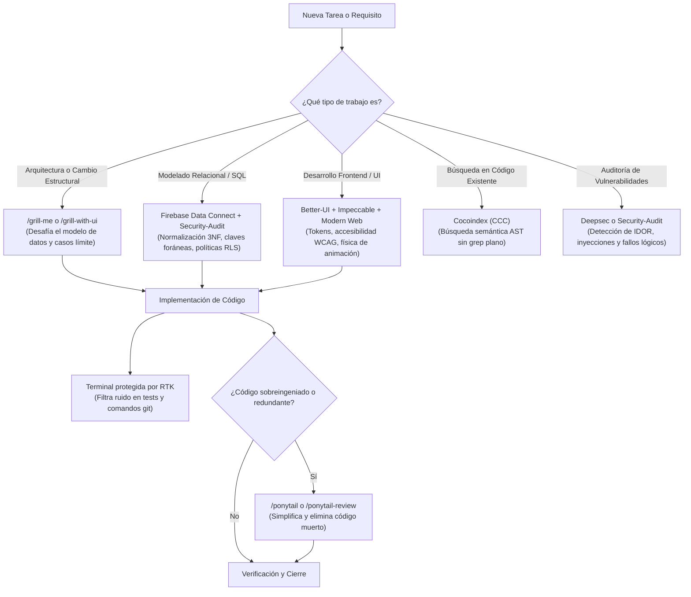

# Guía Oficial de Skills y Herramientas en Antigravity

Esta guía contiene la referencia completa y actualizada de todas las **skills**, **plugins** y **herramientas** activas en tu entorno de desarrollo, su ámbito de instalación (**Global** vs. **Local a este proyecto**), su método de activación, y las recomendaciones técnicas de uso para modelos con razonamiento avanzado.

---

## 📑 Tabla de Contenidos

1. [Resumen de Ámbito: ¿Global o Local?](#1-resumen-de-ámbito-global-o-local)
2. [Cuadro Comparativo y Recomendaciones](#2-cuadro-comparativo-y-recomendaciones)
3. [Tabla Rápida de Comandos y Activación](#3-tabla-rápida-de-comandos-y-activación)
4. [Optimización, Rendimiento y Flujo de Trabajo](#4-optimización-rendimiento-y-flujo-de-trabajo)
   - [RTK (Rust Token Killer)](#rtk-rust-token-killer)
   - [Ponytail Suite](#ponytail-suite)
   - [Druizinhoskill](#druizinhoskill)
   - [Autoskills](#autoskills)
5. [Búsqueda y Navegación de Código](#5-búsqueda-y-navegación-de-código)
   - [Cocoindex-code (CCC)](#cocoindex-code-ccc)
6. [Diseño Frontend, UI y Navegador](#6-diseño-frontend-ui-y-navegador)
   - [Better-UI Suite](#better-ui-suite)
   - [Impeccable](#impeccable)
   - [Modern Web Guidance](#modern-web-guidance)
   - [Chrome DevTools MCP Suite](#chrome-devtools-mcp-suite)
7. [Arquitectura y Validación Crítica](#7-arquitectura-y-validación-crítica)
   - [Grill-me & Grilling](#grill-me--grilling)
   - [Grill-with-ui](#grill-with-ui)
8. [Ciberseguridad y Auditoría](#8-ciberseguridad-y-auditoría)
   - [Deepsec (Vercel Labs)](#deepsec-vercel-labs)
   - [Security-Audit](#security-audit)
9. [Bases de Datos, Cloud y Plataformas](#9-bases-de-datos-cloud-y-plataformas)
   - [Firebase & Firebase Data Connect (PostgreSQL)](#firebase--firebase-data-connect-postgresql)
   - [Flutter & Dart Suite](#flutter--dart-suite)
   - [Gemini API & Omnimodal Suite](#gemini-api--omnimodal-suite)
   - [Google Maps Platform & Android CLI](#google-maps-platform--android-cli)
   - [Built-ins de Antigravity](#built-ins-de-antigravity)
10. [Diagrama de Flujo: Cuándo usar cada herramienta](#10-diagrama-de-flujo-cuándo-usar-cada-herramienta)

---

## 1. Resumen de Ámbito: ¿Global o Local?

Es fundamental distinguir qué herramientas aplican a toda tu máquina y cuáles son exclusivas de `gastosapp`:

```
┌────────────────────────────────────────────────────────────────────────┐
│                        ÁMBITO GLOBAL (Tu Usuario)                      │
│  ~/.gemini/config/plugins/  |  ~/.gemini/config/skills/  |  builtin/   │
│                                                                        │
│  Todas las skills operativas (Better-UI, CCC, Grill-me, Deepsec, RTK,  │
│  Ponytail, Firebase Data Connect, Flutter, Chrome DevTools, etc.)      │
│  -> Disponibles en CUALQUIER proyecto que abras con Antigravity.       │
└───────────────────────────────────┬────────────────────────────────────┘
                                    │ Hereda
                                    ▼
┌────────────────────────────────────────────────────────────────────────┐
│                   ÁMBITO LOCAL (Proyecto: gastosapp)                   │
│                                                                        │
│  1. .agents/rules/antigravity-rtk-rules.md -> Regla local que obliga    │
│     al agente a prefijar con 'rtk' todos los comandos de terminal.     │
│  2. GUIA_SKILLS.md -> Este documento de referencia del proyecto.       │
│  (No hay skills privadas en .agents/skills ni .gemini/skills locales)  │
└────────────────────────────────────────────────────────────────────────┘
```

* **Globales:** Viven en `C:\Users\diegu\.gemini\...`. Puedes usarlas tanto en `gastosapp` como en cualquier otro repositorio.
* **Locales:** Únicamente la regla de terminal en `.agents/rules/` y este archivo de documentación.

---

## 2. Cuadro Comparativo y Recomendaciones

| Herramienta / Suite | Ámbito | ¿Activar por Defecto? | Recomendación Técnica | Propósito Principal |
| :--- | :---: | :---: | :---: | :--- |
| **RTK** | Global (Regla Local) | ✅ **SÍ** | ⭐⭐⭐⭐⭐ **Crítico** | Filtra logs extensos de `git`, `npm`, `cargo`, ahorrando tokens y evitando pérdida de atención (*needle in a haystack*). |
| **Cocoindex (CCC)** | Global | ⚡ **Contextual** | ⭐⭐⭐⭐⭐ **Muy Alto** | Búsqueda semántica y AST con Tree-sitter para saltar a símbolos exactos sin `grep` ciego. |
| **Better-UI Suite** | Global | ⚡ **Contextual** | ⭐⭐⭐⭐⭐ **Imprescindible** | Elimina el "AI Slop" visual. Física de resortes, accesibilidad WCAG 2.2, contraste y tokens. |
| **Impeccable** | Global | ⚡ **Contextual** | ⭐⭐⭐⭐⭐ **Muy Alto** | Garantiza disciplina visual mediante un sistema de diseño persistente (`PRODUCT.md` y `DESIGN.md`). |
| **Modern Web Guidance** | Global | ⚡ **Auto-discovery** | ⭐⭐⭐⭐⭐ **Esencial Web** | Obligatorio para patrones modernos de HTML5, CSS moderno (`:has()`, subgrid) y JS cliente. |
| **Chrome DevTools** | Global | ⚡ **Contextual** | ⭐⭐⭐⭐⭐ **Imprescindible** | Depuración real en navegador (DevTools MCP), cookies, rendimiento LCP y fugas de memoria. |
| **Grill-me & Grilling** | Global | ❌ **Bajo Demanda** | ⭐⭐⭐⭐⭐ **Excelente** | Interrogatorio implacable en consola para desafiar decisiones de diseño antes de escribir código. |
| **Grill-with-ui** | Global | ❌ **Bajo Demanda** | ⭐⭐⭐⭐⭐ **Excepcional** | Panel web en navegador con tarjetas interactivas para responder y debatir decisiones arquitectónicas. |
| **Druizinhoskill** | Global | ⚡ **Contextual** | ⭐⭐⭐⭐⭐ **Avanzado** | Router de esfuerzo cognitivo y orquestación multi-agente entre modelos Flash y modelos Frontier. |
| **Autoskills** | Global | ❌ **Bajo Demanda** | ⭐⭐⭐⭐ **Muy Útil** | Detecta el stack tecnológico del proyecto e instala automáticamente las mejores skills del ecosistema. |
| **Deepsec** | Global | ❌ **Bajo Demanda** | ⭐⭐⭐⭐⭐ **Nativo Thinking** | Escáner de 0-days lógicos de Vercel Labs; diseñado para modelos frontier con Extended Thinking. |
| **Security-Audit** | Global | ⚡ **Modo Guía** | ⭐⭐⭐⭐⭐ **Imprescindible** | Auditoría y modelado de amenazas en 6 fases para backends, APIs y bases de datos. |
| **Firebase Data Connect** | Global | ⚡ **Contextual** | ⭐⭐⭐⭐⭐ **Muy Alto** | Modelado de esquemas relacionales, relaciones normalizadas y consultas PostgreSQL seguras. |
| **Ponytail** | Global | ❌ **Bajo Demanda** | ⚠️ **Solo cuando sea necesario** | En modelos de razonamiento profundo puede provocar sub-ingeniería si se fuerza. Usar `/ponytail` solo para frenar sobreingeniería. |
| **Flutter / Dart** | Global | ⚡ **Contextual** | ⭐⭐⭐⭐⭐ **Específico Stack** | Suite de 24 skills de análisis, testeo y arquitectura para proyectos móviles Flutter. |

---

## 3. Tabla Rápida de Comandos y Activación

| Herramienta | Comando Slash / CLI | Disparador por Lenguaje Natural |
| :--- | :--- | :--- |
| **RTK** | `rtk <cmd>`, `rtk gain`, `rtk discover` | Automático en consola por regla local |
| **Ponytail** | `/ponytail`, `/ponytail lite`, `/ponytail-audit` | *"sé pragmático"*, *"evita sobreingeniería"*, *"solución minimalista"* |
| **Cocoindex (CCC)** | `/ccc`, `ccc search "<query>"` | *"busca dónde se define tal función"*, *"busca la ruta de login"* |
| **Better-UI** | `/better-ui`, `/better-accessibility` | *"pule esta interfaz"*, *"revisa accesibilidad WCAG"*, *"mejora este botón"* |
| **Impeccable** | `/impeccable init`, `/impeccable polish` | *"aplica diseño impecable"*, *"mantén consistencia visual"* |
| **Modern Web** | Automático en tareas HTML/CSS/JS | *"usa las mejores prácticas modernas de CSS/HTML"* |
| **Chrome DevTools** | MCP automático | *"inspecciona la página en el navegador"*, *"revisa la memoria"* |
| **Grill-me** | `/grill-me <tema>` | *"hazme un grill-me sobre esta arquitectura"*, *"desafía mi plan"* |
| **Grill-with-ui** | `/grill-with-ui <tema>` | *"grill with ui sobre mi modelo de datos"*, *"debate en navegador"* |
| **Druizinhoskill** | `/druizinhoskill` | *"usa druizinhoskill"*, *"despacha a flash y audita con modelo principal"* |
| **Autoskills** | Automático / CLI | *"detecta mi stack e instala skills"*, *"autoskills"* |
| **Deepsec** | `deepsec init` | *"escanea el repo con deepsec"*, *"busca vulnerabilidades lógicas"* |
| **Security-Audit** | `/security-audit` | *"¿es seguro este endpoint?"*, *"audita la seguridad del backend"* |
| **Firebase Data Connect** | Auto-discovery | *"diseña el esquema relacional en PostgreSQL"*, *"modela tablas y relaciones"* |

---

## 4. Optimización, Rendimiento y Flujo de Trabajo

### RTK (Rust Token Killer)
* **Ámbito:** Global (Instalado en plugins; forzado localmente en `.agents/rules/antigravity-rtk-rules.md`).
* **Propósito:** Filtra y condensa la salida de comandos (`git status`, `git diff`, `npm test`, `pytest`). Preserva errores y advertencias mientras suprime miles de líneas de relleno innecesario.
* **Por qué es crítico:** Evita que el modelo sufra de "dilución de atención". Una salida de 3.000 líneas de tests desplaza el contexto original; RTK envía solo el test fallido.
* **Uso:**
  ```bash
  rtk git status
  rtk npm test
  rtk gain           # Ver tokens y dólares ahorrados
  rtk proxy <cmd>    # Ejecutar sin filtro si necesitas salida cruda
  ```

### Ponytail Suite
* **Ámbito:** Global.
* **Propósito:** Fuerza al agente a aplicar la filosofía YAGNI (*You Aren't Gonna Need It*) y la solución más directa sin sobreingeniería ni dependencias superfluas.
* **Recomendación:** **No usar como modo permanente.** Los modelos actuales (Gemini 2.5/3.8, Claude 3.7) razonan muy bien sobre arquitectura. Forzar "el código más corto posible" puede provocar código espagueti con atajos (`shortcut:`).
* **Cuándo usarlo:** Úsalo con `/ponytail` o `/ponytail lite` cuando notes que el agente empieza a sugerir librerías pesadas para tareas simples, o usa `/ponytail-audit` para detectar código muerto.

### Druizinhoskill
* **Ámbito:** Global.
* **Propósito:** Orquesta subagentes asignando tareas exploratorias o de codificación pesada a modelos rápidos (Flash) y reservando el modelo de frontera principal para la arquitectura crítica y auditoría final.
* **Activación:** `/druizinhoskill` o solicitar *"utiliza druizinhoskill para despachar esta tarea"*.

### Autoskills
* **Ámbito:** Global.
* **Propósito:** Analiza automáticamente el stack (`package.json`, `requirements.txt`, etc.) y sugiere o instala las mejores skills curadas para el proyecto.

---

## 5. Búsqueda y Navegación de Código

### Cocoindex-code (CCC)
* **Ámbito:** Global.
* **Propósito:** Reemplaza el `grep` plano por un árbol de sintaxis abstracta (AST) con Tree-sitter y base de datos vectorial local. Localiza clases, interfaces y funciones por su rol semántico exacto.
* **Comandos:**
  ```bash
  ccc init -f      # Inicializa el índice del repo
  ccc index        # Actualiza el índice local
  ccc search "dónde se autentica el usuario"
  ```

---

## 6. Diseño Frontend, UI y Navegador

### Better-UI Suite
* **Ámbito:** Global (`~/.gemini/config/plugins/better-ui/`).
* **Habilidades:** `better-ui`, `better-accessibility`, `better-colors`, `better-interface`, `better-layout`, `better-typography`.
* **Propósito:** Garantiza que los componentes tengan radio concéntrico matemático, estados de foco accesibles para lectores de pantalla, física de resortes y contraste WCAG 2.2 AA/AAA.

### Impeccable
* **Ámbito:** Global (`~/.gemini/config/plugins/impeccable/`).
* **Propósito:** Establece un contrato de diseño persistente mediante `PRODUCT.md` y `DESIGN.md`. Evita que el agente invente fuentes, colores o sombras arbitrarias en cada pantalla nueva.
* **Comandos clave:** `/impeccable init`, `/impeccable polish`, `/impeccable audit`.

### Modern Web Guidance
* **Ámbito:** Global (`~/.gemini/config/plugins/modern-web-guidance-plugin/`).
* **Propósito:** Fuerza el uso de estándares web modernos (APIs nativas de HTML dialog, popover, CSS grid, view transitions) en vez de librerías obsoletas o hacks de JavaScript.

### Chrome DevTools MCP Suite
* **Ámbito:** Global.
* **Habilidades:** `chrome-devtools`, `a11y-debugging`, `cookie-debugging`, `debug-optimize-lcp`, `memory-leak-debugging`, `troubleshooting`.
* **Propósito:** Permite al agente interactuar con el navegador Chrome real: inspeccionar el DOM, medir el Largest Contentful Paint (LCP), auditar cookies SameSite/Partitioned y detectar fugas de memoria en JavaScript.

---

## 7. Arquitectura y Validación Crítica

### Grill-me & Grilling
* **Ámbito:** Global (`~/.gemini/config/skills/grill-me/`).
* **Propósito:** Actúa como un *Principal Architect* escéptico que te interroga sobre concurrencia, idempotencia, integridad de datos y casos límite antes de escribir código.
* **Uso:** `/grill-me <propuesta o idea>` en la terminal.

### Grill-with-ui
* **Ámbito:** Global (`~/.gemini/config/plugins/grill-with-ui/`).
* **Propósito:** Ejecuta el interrogatorio arquitectónico en una **interfaz web local interactiva** en tu navegador. Puedes revisar las preguntas en tarjetas, leer las recomendaciones y debatir antes de enviar todas las respuestas en bloque al agente.
* **Uso:** `/grill-with-ui <tema>` o `/grill-with-ui resume`.

---

## 8. Ciberseguridad y Auditoría

### Deepsec (Vercel Labs)
* **Ámbito:** Global (`~/.gemini/config/plugins/deepsec/`).
* **Propósito:** Auditor de seguridad diseñado específicamente para modelos de frontera con razonamiento extendido. Detecta fallos lógicos complejos (IDOR/BOLA, fallos de autorización multitenant, derivación de tokens).
* **Uso:** `deepsec init` o pedir *"audita este módulo con deepsec"*.

### Security-Audit
* **Ámbito:** Global (`~/.gemini/config/plugins/security-audit/`).
* **Propósito:** Marco defensivo de 6 fases inspirado en Cloudflare. En su Modo Guía resuelve consultas puntuales de seguridad (`"¿Es seguro este endpoint?"`), y en modo completo genera matrices de límites de confianza y verificación independiente de vulnerabilidades.

---

## 9. Bases de Datos, Cloud y Plataformas

### Firebase & Firebase Data Connect (PostgreSQL)
* **Ámbito:** Global (`~/.gemini/config/plugins/firebase/`).
* **Habilidades incluidas:** `firebase-data-connect`, `firebase-auth-basics`, `firebase-firestore`, `firestore-rules-creation`, `firebase-security-rules-auditor`, `firebase-hosting-basics`, `firebase-app-hosting-basics`, `firebase-crashlytics`, `firebase-remote-config-basics`.
* **Relevancia especial para modelado relacional:** La skill `firebase-data-connect` contiene directrices avanzadas para el diseño y normalización de esquemas relacionales en PostgreSQL (definición de claves foráneas, índices, consultas seguras y prevención de duplicidad de datos).

### Flutter & Dart Suite
* **Ámbito:** Global (`~/.gemini/config/plugins/flutter/`).
* **Habilidades incluidas:** 24 skills especializadas en Flutter/Dart (análisis estático, pruebas unitarias y de widgets, serialización JSON, navegación declarativa, optimización responsiva y arquitectura limpia).

### Gemini API & Omnimodal Suite
* **Ámbito:** Global (`~/.gemini/config/plugins/gemini-api/`).
* **Habilidades incluidas:** `gemini-api-dev` (SDK Google GenAI), `gemini-live-api-dev` (streaming bidireccional y audio en vivo), `gemini-omni-flash-api` (edición y generación generativa de video).

### Google Maps Platform & Android CLI
* **Ámbito:** Global.
* **Propósito:** Integración de APIs de Google Maps (geocodificación, rutas, Places) y herramientas para el emulador y virtualización de Android (`android-cli`).

### Built-ins de Antigravity
* **Ámbito:** Global nativo (`antigravity/builtin/skills/`).
* **Habilidades:** `automation` (creación de tareas programadas cron), `generative_ui` (renderizado de componentes visuales en chat), `plugin` (gestión de plugins), `ui-plugin-navigation` y `antigravity-guide`.

---

## 10. Diagrama de Flujo: Cuándo usar cada herramienta


