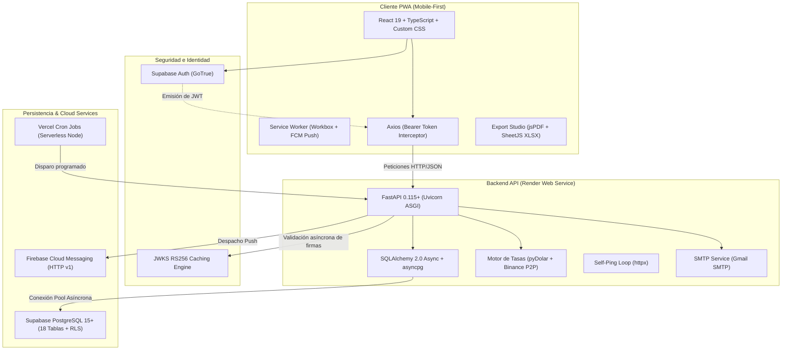

# 🛠️ Stack Tecnológico Completo y Catálogo de Herramientas — GastosApp

> Documento técnico exhaustivo que detalla todas las tecnologías, bibliotecas, motores de base de datos, servicios en la nube y herramientas de soporte utilizadas en **GastosApp**, especificando su propósito y rol en el sistema.

---

## 📑 Tabla de Contenidos

1. [Arquitectura General del Sistema](#1-arquitectura-general-del-sistema)
2. [Frontend (Cliente Web & PWA Mobile-First)](#2-frontend-cliente-web--pwa-mobile-first)
3. [Backend (API REST Asíncrona & Servicios de Negocio)](#3-backend-api-rest-asíncrona--servicios-de-negocio)
4. [Base de Datos, Autenticación y Seguridad](#4-base-de-datos-autenticación-y-seguridad)
5. [Infraestructura en la Nube, DevOps & Tareas Programadas](#5-infraestructura-en-la-nube-devops--tareas-programadas)
6. [Pruebas, Calidad de Código & Herramientas de Desarrollo](#6-pruebas-calidad-de-código--herramientas-de-desarrollo)
7. [Matriz Resumen de Tecnologías](#7-matriz-resumen-de-tecnologías)

---

## 1. Arquitectura General del Sistema

GastosApp opera bajo una arquitectura desacoplada y orientada a eventos para maximizar el rendimiento, la escalabilidad y la disponibilidad:

---

## 2. Frontend (Cliente Web & PWA Mobile-First)

El frontend está ubicado en `frontend/` y configurado en `frontend/package.json`:

| Tecnología / Paquete | Versión | Rol y Propósito en el Proyecto |
| :--- | :--- | :--- |
| **React** | `^19.2.8` | Biblioteca base de interfaz de usuario. Gestiona la jerarquía de componentes, estado reactivo, Virtual DOM y transiciones fluidas. |
| **React DOM** | `^19.2.8` | Renderizador de React específico para el Document Object Model (DOM) de navegadores web. |
| **TypeScript** | `~6.0.2` | Superconjunto tipado de JavaScript. Proporciona chequeo estático estricto para entidades financieras (divisas, transacciones, presupuestos, esquemas de usuario). |
| **Vite** | `^8.2.2` | Herramienta de compilación y empaquetado para desarrollo rápido (HMR instantáneo) y builds optimizados para producción vía Rollup con división de chunks manuales. |
| **@vitejs/plugin-react** | `^6.1.0` | Integración oficial de React con Vite para soportar Fast Refresh y transformación JSX/TSX. |
| **React Router DOM** | `^7.18.3` | Enrutamiento declarativo del lado del cliente (SPA). Gestiona la navegación fluida entre Dashboard, Presupuestos, Herramientas, Red de Panas, Tasas, Reportes y Configuración. |
| **Axios** | `^1.20.0` | Cliente HTTP basado en promesas. Cuenta con interceptores para inyectar automáticamente el token JWT Bearer de Supabase y centralizar el control de errores de la API REST. |
| **Vite Plugin PWA (`vite-plugin-pwa`)** | `^1.3.0` | Motor de Progressive Web App. Genera el Web App Manifest (`manifest.webmanifest`), configura la instalación en la pantalla de inicio (iOS / Android / Desktop) y compila el Service Worker. |
| **Workbox (`workbox-precaching`, `workbox-routing`, `workbox-strategies`, `workbox-background-sync`, `workbox-window`)** | `^7.4.1` | Conjunto de librerías de Google para Service Workers: precaché de assets estáticos, estrategias de red para funcionamiento sin conexión y sincronización de datos en background. |
| **Firebase JS SDK (`firebase`, `@firebase/util`)** | `^12.19.0` | SDK cliente de Google Firebase utilizado específicamente para el módulo de mensajería (`firebase/messaging`), permitiendo suscribir dispositivos al servicio Push y recibir notificaciones en primer o segundo plano. |
| **Supabase Client JS (`@supabase/supabase-js`)** | `^2.115.0` | SDK oficial de Supabase en el navegador para registro, login, refresh automático de sesión, recuperación de credenciales y cierre de sesión. |
| **Lucide React (`lucide-react`)** | `^1.41.0` | Catálogo de iconos vectoriales SVG limpios y semánticos para identificar categorías, transacciones, estados de deuda, navegación y acciones. |
| **date-fns** | `^4.4.0` | Manipulación, formateo, localización y comparación temporal de fechas (utilizado en filtros temporales, vencimiento de gastos fijos y proyecciones). |
| **jsPDF** | `^4.2.1` | Motor de generación de documentos PDF en el navegador para exportación de estados financieros sin recargar el backend. |
| **jsPDF-AutoTable** | `^5.0.9` | Plugin de tablas avanzadas para jsPDF que estructura transacciones, desgloses por categoría y metadatos con paginación automática y estilos ejecutivos. |
| **XLSX / SheetJS (`xlsx`)** | `^0.18.5` | Procesamiento y generación de hojas de cálculo Excel (`.xlsx`) y archivos CSV estructurados con tablas de resumen y transacciones detalladas. |
| **@fontsource/inter** | `^5.3.0` | Distribución tipográfica empaquetada de la fuente *Inter* para garantizar consistencia visual multiplataforma sin depender de peticiones externas a Google Fonts. |
| **Oxlint (`oxlint`)** | `^1.79.0` | Linter de código estático de ultra-alto rendimiento basado en Rust (ecosistema Oxc) para validar reglas de calidad en el frontend. |
| **Sharp (`sharp`)** | `^0.35.4` | Herramienta de manipulación y compresión de imágenes usada en scripts para procesar iconos PWA en diversas resoluciones (`192x192`, `512x512`, `apple-touch-icon`). |
| **Sistema CSS Personalizado** | *Nativo* | Sistema de diseño moderno en CSS puro con variables semánticas, paletas dinámicas (modo claro/oscuro), micro-interacciones táctiles y soporte para safe-area de dispositivos móviles. |
| **Motor de Gráficos SVG Nativo** | *Nativo* | Componentes de gráficos interactivos desarrollados a medida en SVG (`ReportCharts.tsx`) para donas de distribución, barras y líneas de evolución temporal sin sobrecargar el bundle. |

---

## 3. Backend (API REST Asíncrona & Servicios de Negocio)

El backend está ubicado en `backend/` y configurado en `backend/requirements.txt`:

| Tecnología / Paquete | Rol y Propósito en el Proyecto |
| :--- | :--- |
| **Python 3.10+** | Lenguaje de programación base del backend. |
| **FastAPI** | Framework web moderno y asíncrono para estructurar la API REST. Gestiona el ciclo de vida de la aplicación, inyección de dependencias (`Depends`), documentación interactiva (Swagger UI / ReDoc) y routers por dominio. |
| **Uvicorn** | Servidor web ASGI de alta velocidad para ejecutar la aplicación asíncrona de Python sobre el event loop. |
| **SQLAlchemy 2.0 (Async)** | ORM relacional utilizado con `AsyncSession` y `create_async_engine` para consultas asíncronas no bloqueantes, control de transacciones y mapeo de tablas relacionales. |
| **asyncpg** | Driver nativo y asíncrono de PostgreSQL para Python, responsable de la conexión y gestión del pool de conexiones hacia Supabase. |
| **Pydantic v2 & Pydantic-Settings** | Validación estricta de datos de entrada y salida, serialización JSON de alta velocidad y tipado seguro de configuraciones y variables de entorno. |
| **Python-JOSE / Cryptography / PyJWT** | Criptografía y validación de tokens JWT. Permite descargar asíncronamente las claves públicas JWKS de Supabase y validar firmas RS256/HS256 en memoria para autenticar usuarios sin latencia de base de datos. |
| **HTTPX** | Cliente HTTP asíncrono utilizado para:  1. Consultar la cotización del USDT en la API P2P de Binance. 2. Descargar claves públicas JWKS. 3. Ejecutar el bucle de **Self-Ping** para mantener despierto el contenedor en Render. |
| **pyDolarVenezuela & BeautifulSoup4** | Módulos para scraping y consulta automática de las tasas de cambio oficiales del Banco Central de Venezuela (Dólar BCV y Euro BCV). |
| **Cachetools** | Almacenamiento en memoria con política de expiración (`TTLCache`) de 30 minutos para tasas cambiarias y de 24 horas para cotizaciones históricas, previniendo sobrecarga y límites de tasa en APIs externas. |
| **Firebase Admin SDK (`firebase-admin`)** | SDK oficial de Firebase en el backend para autenticar con Google Cloud y despachar notificaciones push web masivas y dirigidas (FCM HTTP v1) a los dispositivos de los usuarios. |
| **Python-Dotenv** | Carga de variables de configuración local desde el archivo `.env`. |
| **SMTPLib & Email (`smtplib`, `email.mime`)** | Módulos estándar de Python configurados para envío transaccional de reportes financieros y estados de cuenta directamente al correo electrónico de los usuarios vía SMTP (Gmail SMTP). |

---

## 4. Base de Datos, Autenticación y Seguridad

Configurado en `schema.sql`, `database/migrations/` y políticas RLS:

| Componente | Rol y Propósito en el Proyecto |
| :--- | :--- |
| **PostgreSQL 15+ (en Supabase)** | Motor relacional central. Almacena el modelo canónico (18 tablas) con integridad referencial estricta (`ON DELETE CASCADE` y `ON DELETE SET NULL`), índices de alto rendimiento y tipos avanzados (`UUID`, `NUMERIC(12, 4)`, `TIMESTAMPTZ`, `JSONB`). |
| **Row Level Security (RLS)** | Políticas de seguridad a nivel de fila (`rls_policies.sql`, `rls_connections.sql`). Aseguran que cada usuario solo acceda a su propia información, permitiendo compartir datos únicamente bajo las reglas explícitas de la red de "Panas" (`shares` y `share_members`). |
| **Supabase Auth (GoTrue)** | Infraestructura de identidad, registro, inicio de sesión seguro, cifrado de contraseñas y emisión de JSON Web Tokens (JWT). |
| **PL/pgSQL Triggers & Functions** | Lógica de base de datos automatizada, como el trigger `handle_new_user`, que inicializa el perfil y crea las categorías por defecto cuando se registra un usuario nuevo. |

---

## 5. Infraestructura en la Nube, DevOps & Tareas Programadas

| Servicio / Infraestructura | Rol y Propósito en el Proyecto |
| :--- | :--- |
| **Vercel** | Plataforma de alojamiento y distribución para el Frontend PWA, utilizando su red Edge global CDN para tiempos de carga mínimos. |
| **Vercel Serverless Functions (`@vercel/node`)** | Endpoint serverless en `frontend/api/cron/notifications.ts` que valida el secreto `CRON_SECRET` y orquesta la ejecución del cron en el backend. |
| **Vercel Cron Jobs (`vercel.json`)** | Planificador de tareas en la nube que ejecuta dos ventanas diarias de revisión y notificación:  • **9:00 AM VET (13:00 UTC):** Gastos fijos por vencer hoy, deudas pendientes y cobros del día. • **8:00 PM VET (23:00 UTC):** Vencimientos de mañana y alerta de inactividad (3+ días sin registros). |
| **Render** | Plataforma de alojamiento en la nube que ejecuta el backend FastAPI como un Web Service en un contenedor Linux. |
| **Firebase Cloud Messaging (FCM)** | Red global de entrega de mensajes push web de Google para entregar avisos instantáneos y alertas programadas a dispositivos móviles y de escritorio. |
| **Binance P2P Public API** | Fuente pública de mercado en tiempo real para obtener el valor del USDT contra Bolívares sin intermediarios. |
| **Gmail SMTP (Google Workspace / Gmail)** | Servidor de correo saliente para el envío de estados de cuenta y reportes financieros adjuntos por email. |

---

## 6. Pruebas, Calidad de Código & Herramientas de Desarrollo

| Herramienta | Rol y Propósito en el Proyecto |
| :--- | :--- |
| **Pytest (`pytest`, `pytest-asyncio`)** | Framework de pruebas unitarias e integración en el backend (`backend/tests/`) para verificar lógica de presupuestos, sincronización de panas, notificaciones y cálculos de tasas. |
| **Node.js Test Runner (`.test.mjs`)** | Entorno de ejecución de pruebas unitarias para módulos críticos de cálculo financiero en el frontend (ej. `currencySummary.test.mjs`). |
| **Git** | Sistema de control de versiones distribuido para el seguimiento de cambios y colaboración del código fuente. |

---

## 7. Matriz Resumen de Tecnologías

| Dominio | Tecnologías Clave |
| :--- | :--- |
| **Lenguajes** | TypeScript 6, Python 3.10+, SQL (PostgreSQL), HTML5, CSS3 |
| **Frontend** | React 19, React Router 7, Vite 8, Axios, Lucide React, date-fns, @fontsource/inter |
| **PWA & Offline** | Vite Plugin PWA, Workbox (Precaching, Routing, Strategies, Sync) |
| **Exportación** | jsPDF, jsPDF-AutoTable, SheetJS (XLSX), CSV nativo, Canvas SVG-to-PNG |
| **Backend API** | FastAPI, Uvicorn, SQLAlchemy 2.0 Async, asyncpg, Pydantic v2 |
| **Seguridad & Auth** | Supabase Auth, JWKS asimétrico (RS256), python-jose, cryptography, RLS |
| **Integraciones Financieras** | pyDolarVenezuela, BCV Scraping (BeautifulSoup4), Binance P2P API, TTLCache |
| **Mensajería & Push** | Firebase Admin SDK (Backend), Firebase JS SDK (Frontend), FCM HTTP v1 |
| **Correo Saliente** | Python smtplib / email.mime sobre Gmail SMTP |
| **Base de Datos** | PostgreSQL 15+ alojado en Supabase con RLS y Triggers PL/pgSQL |
| **Infraestructura Cloud** | Vercel (Frontend & Crons), Render (Backend), Supabase Cloud, Firebase Cloud |
| **Calidad & Linter** | Oxlint, Pytest, Node Test Runner |
